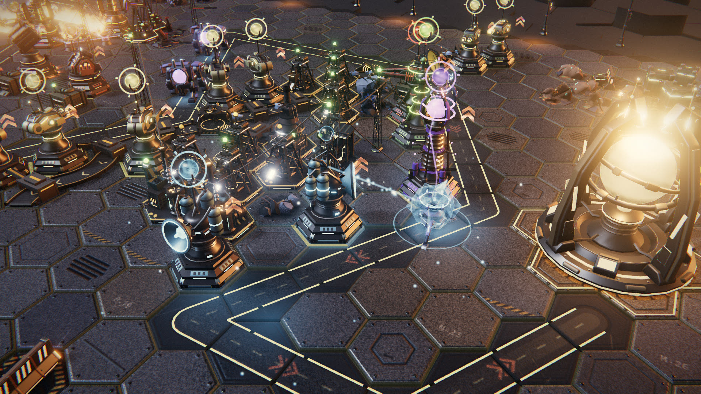
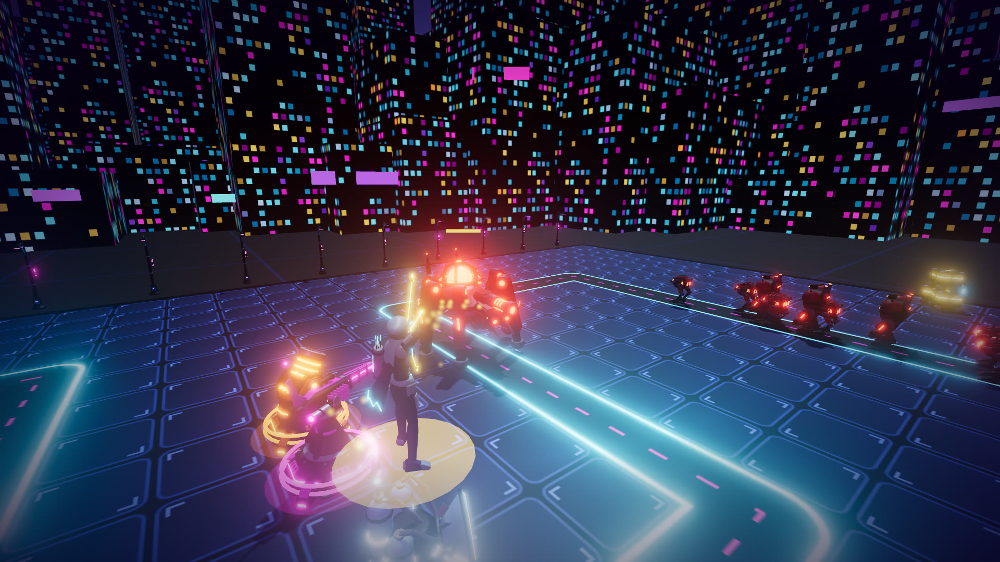

# BEATSPIRE

**Build the grid. Become the storm.** A hex-grid tower defense where no gun fires for free: every bolt, shell and missile is dug, smelted and carried to it by the factory you build between the roads. Plays free in the browser, with mouse and keyboard or touch.

**Play:** https://bigzaiko.github.io/beatspire/


| | | |
|---|---|---|
|  |  |  |
|  |  |  |
|  |  | [](public/media/trailer.mp4) |

- **Towers** - build and upgrade ten tower types on the hexes beside the roads. Tags over the spawn gates show what the next wave sends down each road. A Colossus arrives every fifth wave, a Gyre mini-boss in between.
- **Supply** - a tower fires only what it is fed, and it starts empty. It keeps one item in hand, and every item reaches it through a Transfer Arm (fluids by pipe, power by reach). Supply crates on the deck feed a tower built next to them until they run out. The Pulse Turret runs on iron ore: Mine, arm, turret in a row is a whole supply line; every later tower adds one step: power (Cryo, Arc, Beacon), crude oil by pipe (Firewall Pylon), smelted copper plates (Railgun), pressed shells (Mortar), energy cells (Lance, Graviton Well), missiles (Missile Battery). A tower that runs dry stops firing and shows what it is missing. A Pulse Turret Mk3 can fire plasma shells and a Firewall Pylon Mk3 can burn petrol for more damage, but upgrading never changes what a tower eats: the Plasma Rounds or Petrol Burners card puts a switch into each Mk3's panel, and you convert a tower when its new supply line stands.
- **The factory** - deposits of iron, copper, coal and oil on every map. Sixteen buildings, each with one job: Transfer Arm, Conveyor Belt, Belt Splitter, Belt Tunnel, Mine, Generator, Power Pole, Pumpjack, Pipe, Pipe Tunnel, Smelter, Frame Works, Shell Press, Cell Plant, Refinery and Missile Works. All of them are on the Factory bar from the start; a run begins with the Transfer Arm and the Mine, and the hatched ones name the card that unlocks them. Production is slow on purpose (a mine digs an ore about every 3 seconds, about what one turret burns): arms, mines, pumpjacks, plants and generators upgrade twice for credits to work faster.
- **Transfer Arms** - nothing hands anything on by itself. A mine, a plant or a belt never feeds what stands next to it: every item that passes from one thing into another, or onto and off a belt, is carried by a Transfer Arm. An arm takes one tile; it takes from the tile behind it and delivers to the tile in front, straight through the hex. R turns it, the preview turns by itself where the direction is obvious, and a drag lays a line of arms that hand on to each other. An arm picks up only what its target will take right now, so nothing jams in its hand, and its panel has a filter (one kind of item only) to pull that kind off a mixed belt. So a belt can run past anything without feeding it, and you decide what goes where. The one exception keeps the first minute simple: a supply crate feeds the towers right beside it.
- **Logistics** - the opening is arm lines: mine, arm, turret; later mine, arm, smelter, arm, tower. Belts come with the Conveyor Belts card, which is in the first level-up offers until you take it. A belt only carries: arms put items on it and take them off further along. Belts merge where one points into another; a Belt Splitter deals items out to several lines. Pipes carry crude oil and petrol and feed what they touch. Power poles wire up to 5 tiles apart (also across roads) and power everything within 2 tiles. The Tunnels card unlocks Belt and Pipe Tunnels that pass up to 4 tiles under roads, towers and buildings: it is offered from level 4 and is put into the offers from level 7 until taken, so roads never cut a supply line off for long. Every map guarantees its opening: each iron crate has an iron deposit with room for mine, arm and turret in a straight line beside the road.
- **Waves on call, time stands still between them** - no wave starts by itself unless you switch Auto waves on, and the first one never does. Between waves nothing is made and nothing moves: a broken rust ring with a hologram of the missing item marks every tower and building that will lack something when the wave starts, its panel lists what feeds it, what is missing and which hand-off is not there ("no Transfer Arm brings it iron ore"), and the Power gauge shows what the grids need against what they have. While you place a piece, green rings mark everything that will be supplied, dashes run along the route the piece would get and brackets close on what it would feed or power; hold V to see the green rings at any time.
- **Tutorial** - a guided run on Switchback through crate, turret, mine, Transfer Arm, more arm lines, the Conveyor Belts card, a belt between two arms, upgrades and power. Its markers show the exact hexes and the way each arm has to point. It is the second button in the menu, the first solo run starts it by itself, and it can be replayed from How to play.
- **Upgrades** - towers go to Mk3 for credits (the heavy ones for building materials too); arms, mines, pumpjacks, plants and generators upgrade twice and work 1.6 and 2.3 times as fast.
- **Credits and materials** - kills and cleared waves pay credits. A Frame Works turns iron plates into building materials, which the stronger towers and their upgrades cost on top.
- **Targeting** - every tower that picks a target can be told which: First, Last, Strongest, Weakest, Fastest or Slowest. Select the tower and choose the mode in its panel, or step through them with T (Shift+T backwards). Set all, or a Shift-click on a mode, gives it to every tower of that kind and to the ones built later; the kind remembers it. A token on the range ring shows the mode, and a bracket with a thin line marks the enemy the selected tower is aiming at. Beacons, Firewall Pylons and Graviton Wells take no single target. Railguns and Lances start on Strongest, the rest on First.
- **Icons, not sentences** - every resource, building and tower has an icon. The build bar shows under each tower what it has to be fed, and under each building what it makes and the power it draws. Point at an icon anywhere (the bar, the panels, a blueprint card, the gauges, the tutorial, How to play), give it the keyboard focus, or tap or long-press it, and a tooltip draws how it is made, from the deposit to the product, with the buildings, amounts, times and power.
- **Tower specials** - every tower charges a special. Right-click a charged tower to fire it, selected or not; on a touch screen hold it or double-tap it. (Space or the button in its panel work on the selected tower.) A special that is not ready answers on the tower itself with a fizzle and says what it waits for. The tower then reboots for a few seconds.
- **Machines** - nine kinds and the mites, among them the Gyre (a wheel whose spinning rim deflects hits until you slow or freeze it), the Broodcarrier (its mites climb a tower and jam it) and the Titan: one finale per campaign that lands on the gate, wipes the road and stuns every tower. Its hull turns most tower fire; tower specials hit it at full strength.
- **Cards** - every level, pick one of three out of 75: tower blueprints, production cards, ammunition cards, upgrades for each tower type, factory upgrades, economy. A blueprint unlocks only its tower; the buildings its supply needs come with production cards of their own (Conveyor Belts, Power Grid, Smelting, Frame Works, Shell Press, Oil Field, Cell Plant, Refinery, Missile Works, Belt Splitter, Tunnels). Cards have preconditions: a card is offered only once the cards it builds on are taken and its level is reached (the Shell Press needs Smelting and the Power Grid; Plasma Rounds needs the Shell Press), and some are guaranteed by a level. A blueprint card marks each resource its tower needs as one you can make already or not yet, and names the production cards still missing; once you take it, those are put into the next offers first, one per offer in the order they build on each other. An ammunition card comes within three levels of its plant card once you have a Mk2 or Mk3 of its tower. A card put into an offer that you pass over steps back for two levels, and after three times it is no longer pushed (it can still come by chance), unless a tower you have built cannot be fed without it. A production card shows what it builds, which of your towers it serves and which cards it leads to. The Paths view on the level-up screen (and in How to play) draws the whole tree with what you hold.
- **Maps and modes** - 38 pre-made maps in three tiers (one to three roads, some with ramps and bridges) or a generated map from a seed. Three difficulties with 20, 25 or 30 waves, and a Survival mode with no last wave.
- **Map editor** - draw up to three roads on the hex grid, raise them into ramps and bridges, place the core, wreckage and starting towers, set credits and core integrity. The Resources tool paints iron, copper, coal and oil deposits, or leaves them to the rules that lay them out automatically; the editor shows the deposits and crates a run would start with and warns when something is missing. Maps are saved locally and can be shared as a code.
- **Multiplayer** - online co-op and 1v1 are switched off for now: the factory is not kept in sync between two browsers yet. The code for them is still there, and they are coming back.
- **Music** - seven built-in synthwave tracks (90 to 124 BPM). Tick the ones you want and they play one after another as your playlist, or add YouTube and Spotify links of your own. YouTube playlists play item by item, and the beat effects follow each song's BPM where it is known (see [Music and streaming setup](#music-and-streaming-setup)).
- **Settings** - volume, graphics quality, and the impact and beat pulse effects (on or off, where they show, intensity, colour). Records per map and difficulty are kept in the browser.

## Safe by design

No accounts of ours, no ads, no tracking, no server of ours. The site is static files with a strict Content-Security-Policy. All code and fonts are bundled. The only third-party content is the YouTube or Spotify player, and it loads only when you add a link to the playlist and press play. Online BPM lookups run only when you tick them. Multiplayer connects two browsers directly (WebRTC). The public PeerJS relay is only used to introduce them, and every message from the other player is validated before use. Peer-to-peer means the other player can see your IP address, so share room codes only with people you trust.

## Music and streaming setup

The Music sheet plays the built-in score, pasted YouTube and Spotify links (in their embeds), and, once connected, Spotify itself.

**Spotify Connect is switched off on the published site.** Spotify's [Developer Policy](https://developer.spotify.com/policy) (section III) prohibits games from using its API and prohibits syncing recordings with visuals, so the sign-in panel is hidden and Spotify's sign-in, API and SDK hosts are left out of the Content-Security-Policy. Pasted Spotify links still play in Spotify's own embed. The code stays in the repo: a build with `VITE_SPOTIFY_CONNECT=1` (plus the Client ID below) turns it on, at the builder's own risk.

**Spotify Connect (full tracks, playlists, liked songs).** The game signs in with Spotify's Authorization Code flow with PKCE: no client secret exists anywhere, the code is removed from the address bar on return, the access token stays in memory, and only the refresh token is stored (sessionStorage, or localStorage when the player ticks "Stay connected"). Disconnect clears it; full revocation is on spotify.com/account/apps. What the owner has to do once, on https://developer.spotify.com/dashboard:

1. Create an app (the owner's own Spotify account needs Premium) and tick **Web API** and **Web Playback SDK**.
2. Add these Redirect URIs exactly, character for character:
   - `https://bigzaiko.github.io/beatspire/play.html`
   - `http://127.0.0.1:5183/play.html` for local development. Spotify refuses `localhost`, so start the dev server with `npm run dev -- --host 127.0.0.1` and open that address (`http://[::1]:5183/play.html` also works if you register it).
3. Under **User Management**, add every Spotify account that should be able to connect. New apps run in development mode: at most 5 listed users, everybody else gets a 403 (the sheet says so). Extended quota is only granted to organisations, so this stays an invite-only feature.
4. Give the build the Client ID (it is public, not a secret): put `VITE_SPOTIFY_CLIENT_ID=<32 hex characters>` in a `.env.production` (and `.env.development`) file, or set it as an environment variable of the `npm run build` step in `.github/workflows/deploy.yml`. Without it, the sheet offers "Advanced: use your own Spotify Client ID", where a player can paste the ID of an app they registered themselves with the same steps.

Scopes requested: `streaming user-read-email user-read-private user-read-playback-state user-modify-playback-state playlist-read-private playlist-read-collaborative user-library-read`. Full tracks need Premium and a browser with encrypted media (Widevine); without them, playback falls back to the Spotify embed with a note. Since February 2026 Spotify only lists the tracks of playlists you own or collaborate on; other playlists can still be played. iOS Safari is best effort.

Before turning this on, read the [Spotify Developer Policy](https://developer.spotify.com/policy): its section III lists "Do not create a game" and "Do not synchronize any sound recordings with any visual media" among prohibited uses, and asks that Spotify audio is not mixed with other audio. The game mutes its own score while Spotify plays, but its sound effects keep playing. Whether to enable Spotify Connect is the owner's decision.

**BPM.** The beat effects follow the BPM of the track that plays, switching at every track change and tied to the playback position (after seek, pause and resume too). In order: your own value (typed, tapped, or set with ×2 / ÷2; remembered per track), the local cache, Spotify's own audio features (closed to new apps since November 2024, used only if the app still has access), and, only after the player ticks "Look up the BPM of songs online", [ReccoBeats](https://reccobeats.com) by Spotify track id. YouTube videos are matched by title and channel: through the player's Spotify connection (search), or through [GetSongBPM](https://getsongbpm.com) if the build has `VITE_GETSONGBPM_KEY` set (its terms require the visible backlink the sheet then shows; the CSP adds `api.getsong.co` only in that case). Looked-up values are folded into 70 to 180 BPM; automated estimates are often off by half or double, which ×2 / ÷2 fix.

**Listen.** For anything else, "Listen" in the player finds tempo and beat from the sound itself: the tab's audio on desktop Chrome and Edge (the browser asks to share this tab with audio), the microphone elsewhere. It starts only on that button and nothing leaves the browser. It cannot read the audio inside the YouTube or Spotify frames directly; whether Chrome's tab capture includes Spotify's DRM-protected audio is untested.

**YouTube.** A pasted playlist shows its videos (titles appear as each one plays; the player gives no titles in advance without an API key), with next/previous, shuffle, loop and a BPM per video. YouTube's terms require a playing embed to stay visible at 200 x 200 px or more with nothing over it, so "Hide" shrinks the player to that size instead of hiding it.

**Testing the real thing (owner, by hand).** Headless tests run against mocked Spotify and YouTube only. With a listed Premium account: open the dev server at 127.0.0.1, Music, Connect Spotify, approve, check the sheet comes back connected and the address bar has no `?code`; open a playlist, play a track, check the dock shows cover, title, artists and PLAY ON SPOTIFY, press Next and watch the BPM switch, seek and check the pulse stays on the beat; tick the online lookup and see BPMs fill in; Disconnect and reload: no session. Repeat once with an account that is not listed (expect the allowlist message) and once without Premium (expect the embed fallback).

## Reporting a bug

In the game, **Report on GitHub** (in the pause menu, the main menu and How to play, or <kbd>F8</kbd> anywhere; on a phone, pause first) pauses the run and opens a short form: a one-line summary, what happened, and what you expected. A preview shows exactly what the issue will say. Then it opens a new issue on this repository in a new tab, filled in. **Nothing is sent from the game**: you read it on GitHub and submit it yourself, from your own GitHub account (you need one).

The issue holds your text, the game version, browser, OS, graphics card, screen size, quality settings, the run (mode, map, difficulty, wave), the last ~200 game events and your actions, the last 50 console errors and warnings (messages only, without the query strings of any address), and a **state block**: the whole game state, packed (`BSR1:...`), from which the run can be rebuilt exactly. How it gets there depends on its size:

1. It all fits in the link: GitHub opens with everything filled in.
2. Too long for a link (a big factory): GitHub opens with the text filled in and a line saying PASTE STATE HERE. The game put the state on your clipboard: select that line and paste (<kbd>Ctrl</kbd>+<kbd>V</kbd>, or long-press and Paste on a phone).
3. Too long for one issue: the game also downloads a report file (with a screenshot inside); drag it into the issue where it says so.

**Copy screenshot** puts a picture of the game on your clipboard to paste into the issue (browsers that cannot do that say so). The limits were measured against GitHub: a new-issue link stops working past about 7000 characters for a signed-out visitor (the login redirect carries the whole link once more), and GitHub refuses any link past about 8150; an issue body may be 65536 characters. `src/report.ts` keeps the numbers and how they were found.

**Reproducing a report** (for the owner):

```bash
node tools/repro.ts issue.txt               # a saved issue body, a downloaded report file, or just the block; '-' reads stdin
node tools/repro.ts issue.txt --steps 1800  # run 30 s on and list what changed
node tools/repro.ts issue.txt --wave --watch fac:12 --watch tower:3   # call the next wave, follow one arm and one tower
```

It prints the map, wave, credits and counts, the supply diagnosis of every building and tower (with the arms' and mines' state), then runs the sim forward. It exits with code 2 when the block is missing, damaged or from another format version. In the game itself, **Load report** (on the dev server, or any build with `?debug=1` in the address) takes a pasted block or a report file and continues from exactly that state, paused. `node tools/smoke.ts` checks that a restored state goes on step for step like the original.

## Develop

```bash
npm install
npm run dev        # http://localhost:5183
npm run build      # static site in dist/
node tools/balance.ts               # headless bot runs for balancing (see the file for its arguments)
node tools/smoke.ts        # headless checks: maps, the factory, hostile input, co-op sync
node tools/hex-test.ts     # hex grid maths
node tools/mapgen-test.ts  # map generator
node tools/music-test.ts   # Spotify sign-in, links, BPM lookups and cache, beat maths, beat detector
```

Media for the landing page and this README are rendered from the running dev server on the GPU (headless Chromium, ffmpeg):

```bash
node tools/previews.mjs    # tower, machine, factory building and deposit stills + the hover clips (public/media, public/media/prev)
node tools/shot.mjs        # gallery screenshots (shot-*.jpg); names as arguments for some of them
node tools/trailer.mjs     # trailer.mp4 with the game's own score and sounds, and poster.jpg
```

The landing page also loads smaller copies (`public/media/sm/`, picked by `srcset`) and a lighter hero background (`hero.jpg`). Remake them after the stills or screenshots change:

```bash
cd public/media && mkdir -p sm
for f in shot-*.jpg; do ffmpeg -y -loglevel error -i $f -vf scale=960:-2:flags=lanczos -q:v 5 sm/$f; done
for f in tower_*.jpg enemy_*.jpg fac_*.jpg dep_*.jpg; do ffmpeg -y -loglevel error -i $f -vf scale=320:-2:flags=lanczos -q:v 4 sm/$f; done
ffmpeg -y -loglevel error -i shot-factory.jpg -q:v 9 hero.jpg
```

The landing page (`index.html`, `src/landing.ts`, `src/landing.css`) holds only the copy. Its tower, machine and factory cards, the supply-chain diagram and the numbers in the hero are built by `src/landing.ts` from `src/game/data.ts` (and a few constants of `factory.ts` and `map.ts`), so a balance change shows up on the page with the next build.

Models are generated procedurally with Blender: `blender -b --python tools/blender/build_models.py`.

Built with Three.js, TypeScript, Vite, PeerJS and Blender. MIT licensed.
