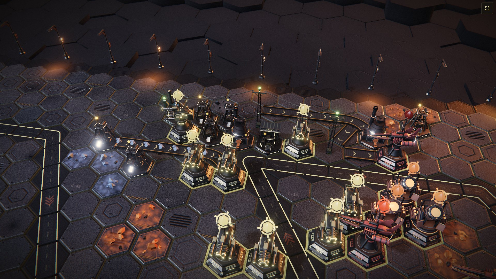
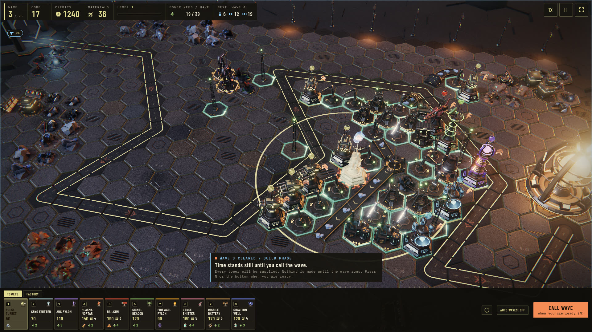
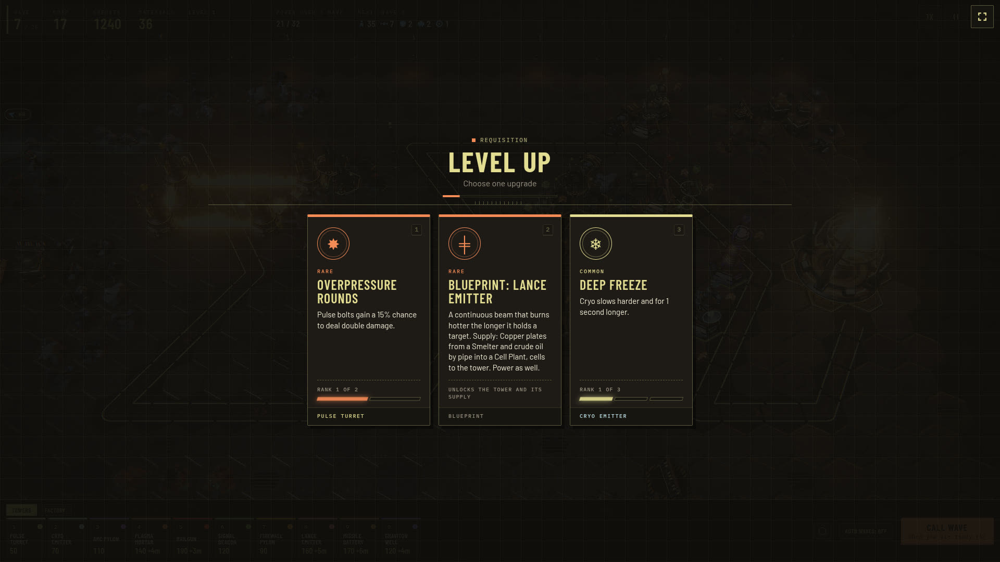
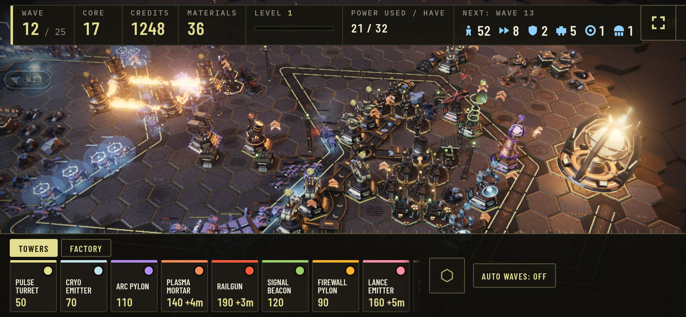

# BEATSPIRE

**Build the grid. Become the storm.** A hex-grid tower defense where no gun fires for free: every bolt, shell and missile is dug, smelted and carried to it by the factory you build between the roads. Plays free in the browser, with mouse and keyboard or touch.

**Play:** https://bigzaiko.github.io/beatspire/



| | | |
|---|---|---|
|  |  |  |
|  |  |  |
|  |  | [](public/media/trailer.mp4) |

- **Towers** - build and upgrade ten tower types on the hexes beside the roads. Tags over the spawn gates show what the next wave sends down each road. A Colossus arrives every fifth wave, a Gyre mini-boss in between.
- **Supply** - a tower fires only what it is fed, and it starts empty. It keeps one item in hand and pulls the next off its belt or pipe as it fires. Supply crates on the deck feed a tower built next to them until they run out. The Pulse Turret runs on iron ore straight from a Mine; every later tower adds one step: power (Cryo, Arc, Beacon), crude oil by pipe (Firewall Pylon), smelted copper plates (Railgun), pressed shells (Mortar), energy cells (Lance, Graviton Well), missiles (Missile Battery). A tower that runs dry stops firing and shows what it is missing. At Mk3 the Pulse Turret fires plasma shells and the Firewall Pylon burns petrol, so their supply line grows with them.
- **The factory** - deposits of iron, copper, coal and oil on every map. Fifteen buildings, each with one job: Mine, Generator, Power Pole, Pumpjack, Pipe, Pipe Tunnel, Smelter, Frame Works, Shell Press, Cell Plant, Refinery, Missile Works, Conveyor Belt, Belt Splitter and Belt Tunnel. A run starts with only the Mine and the Belt; each blueprint card unlocks a tower together with the buildings its supply needs, tier by tier. Production is slow on purpose (a mine digs an ore about every 3 seconds, about what one turret burns): mines, pumpjacks, plants and generators upgrade twice for credits to work faster.
- **Logistics** - nothing has an output side. A building hands what it makes to a neighbour that needs it, or to a belt beside it when something further down that belt needs it, so belts never fill with things nobody wants. Towers and buildings take what they need from a belt that points at them or runs past them: one belt feeds a row of towers. Pipes carry crude oil and petrol. Power poles wire up to 5 tiles apart (also across roads) and power everything within 2 tiles. Belts merge where one points into another; a Belt Splitter (from the first tier-2 blueprint) deals items out to several lines. The Tunnels card unlocks Belt and Pipe Tunnels that pass up to 4 tiles under roads, towers and buildings.
- **Waves on call, time stands still between them** - no wave starts by itself unless you switch Auto waves on, and the first one never does. Between waves nothing is made and nothing moves: a broken rust ring with a hologram of the missing item marks every tower and building that will lack something when the wave starts, its panel lists what feeds it and what is missing, and the Power gauge shows what the grids need against what they have. While you place a piece, green rings mark everything that will be supplied, dashes run along the route the piece would get and brackets close on what it would feed or power; hold V to see the green rings at any time.
- **Tutorial** - a guided run on Switchback through crate, turret, mine, belt, cards and power. It is the second button in the menu, the first solo run starts it by itself, and it can be replayed from How to play.
- **Upgrades** - towers go to Mk3 for credits (the heavy ones for building materials too); mines, pumpjacks, plants and generators upgrade twice and work 1.6 and 2.3 times as fast.
- **Credits and materials** - kills and cleared waves pay credits. A Frame Works turns iron plates into building materials, which the stronger towers and their upgrades cost on top.
- **Tower specials** - every tower charges a special. Select a charged tower and fire it (Space or the button in its panel). The tower then reboots for a few seconds.
- **Machines** - nine kinds and the mites, among them the Gyre (a wheel whose spinning rim deflects hits until you slow or freeze it), the Broodcarrier (its mites climb a tower and jam it) and the Titan: one finale per campaign that lands on the gate, wipes the road and stuns every tower. Its hull turns most tower fire; tower specials hit it at full strength.
- **Cards** - every level, pick one of three out of 63: tower blueprints, upgrades for each tower type, factory upgrades, economy.
- **Maps and modes** - 38 pre-made maps in three tiers (one to three roads, some with ramps and bridges) or a generated map from a seed. Three difficulties with 20, 25 or 30 waves, and a Survival mode with no last wave.
- **Map editor** - draw up to three roads on the hex grid, raise them into ramps and bridges, place the core, wreckage and starting towers, set credits and core integrity. The Resources tool paints iron, copper, coal and oil deposits, or leaves them to the rules that lay them out automatically; the editor shows the deposits and crates a run would start with and warns when something is missing. Maps are saved locally and can be shared as a code.
- **Multiplayer** - online co-op and 1v1 are switched off for now: the factory is not kept in sync between two browsers yet. The code for them is still there, and they are coming back.
- **Music** - seven built-in synthwave tracks (90 to 124 BPM). Tick the ones you want and they play one after another as your playlist, or add YouTube and Spotify links of your own. YouTube playlists play item by item, and the beat effects follow each song's BPM where it is known (see [Music and streaming setup](#music-and-streaming-setup)).
- **Settings** - volume, graphics quality, and the impact and beat pulse effects (on or off, where they show, intensity, colour). Records per map and difficulty are kept in the browser.

## Safe by design

No accounts of ours, no ads, no tracking, no server of ours. The site is static files with a strict Content-Security-Policy. All code and fonts are bundled. The only third-party content is the YouTube or Spotify player, and it loads only when you add a link to the playlist and press play. Online BPM lookups run only when you tick them. Multiplayer connects two browsers directly (WebRTC). The public PeerJS relay is only used to introduce them, and every message from the other player is validated before use. Peer-to-peer means the other player can see your IP address, so share room codes only with people you trust.

## Music and streaming setup

The Music sheet plays the built-in score, pasted YouTube and Spotify links (in their embeds), and, once connected, Spotify itself.

**Spotify Connect is switched off on the published site.** Spotify's [Developer Policy](https://developer.spotify.com/policy) (section III) prohibits games from using its API and prohibits syncing recordings with visuals, so the sign-in panel is hidden and Spotify's sign-in, API and SDK hosts are left out of the Content-Security-Policy. Pasted Spotify links still play in Spotify's own embed. The code stays in the repo: a build with `VITE_SPOTIFY_CONNECT=1` (plus the Client ID below) turns it on, at the builder's own risk.

**Spotify Connect (full tracks, playlists, liked songs).** The game signs in with Spotify's Authorization Code flow with PKCE: no client secret exists anywhere, the code is removed from the address bar on return, the access token stays in memory, and only the refresh token is stored (sessionStorage, or localStorage when the player ticks "Stay connected"). Disconnect clears it; full revocation is on spotify.com/account/apps. What the owner has to do once, on https://developer.spotify.com/dashboard:

1. Create an app (the owner's own Spotify account needs Premium) and tick **Web API** and **Web Playback SDK**.
2. Add these Redirect URIs exactly, character for character:
   - `https://bigzaiko.github.io/beatspire/play.html`
   - `http://127.0.0.1:5183/play.html` for local development. Spotify refuses `localhost`, so start the dev server with `npm run dev -- --host 127.0.0.1` and open that address (`http://[::1]:5183/play.html` also works if you register it).
3. Under **User Management**, add every Spotify account that should be able to connect. New apps run in development mode: at most 5 listed users, everybody else gets a 403 (the sheet says so). Extended quota is only granted to organisations, so this stays an invite-only feature.
4. Give the build the Client ID (it is public, not a secret): put `VITE_SPOTIFY_CLIENT_ID=<32 hex characters>` in a `.env.production` (and `.env.development`) file, or set it as an environment variable of the `npm run build` step in `.github/workflows/deploy.yml`. Without it, the sheet offers "Advanced: use your own Spotify Client ID", where a player can paste the ID of an app they registered themselves with the same steps.

Scopes requested: `streaming user-read-email user-read-private user-read-playback-state user-modify-playback-state playlist-read-private playlist-read-collaborative user-library-read`. Full tracks need Premium and a browser with encrypted media (Widevine); without them, playback falls back to the Spotify embed with a note. Since February 2026 Spotify only lists the tracks of playlists you own or collaborate on; other playlists can still be played. iOS Safari is best effort.

Before turning this on, read the [Spotify Developer Policy](https://developer.spotify.com/policy): its section III lists "Do not create a game" and "Do not synchronize any sound recordings with any visual media" among prohibited uses, and asks that Spotify audio is not mixed with other audio. The game mutes its own score while Spotify plays, but its sound effects keep playing. Whether to enable Spotify Connect is the owner's decision.

**BPM.** The beat effects follow the BPM of the track that plays, switching at every track change and tied to the playback position (after seek, pause and resume too). In order: your own value (typed, tapped, or set with ×2 / ÷2; remembered per track), the local cache, Spotify's own audio features (closed to new apps since November 2024, used only if the app still has access), and, only after the player ticks "Look up the BPM of songs online", [ReccoBeats](https://reccobeats.com) by Spotify track id. YouTube videos are matched by title and channel: through the player's Spotify connection (search), or through [GetSongBPM](https://getsongbpm.com) if the build has `VITE_GETSONGBPM_KEY` set (its terms require the visible backlink the sheet then shows; the CSP adds `api.getsong.co` only in that case). Looked-up values are folded into 70 to 180 BPM; automated estimates are often off by half or double, which ×2 / ÷2 fix.

**Listen.** For anything else, "Listen" in the player finds tempo and beat from the sound itself: the tab's audio on desktop Chrome and Edge (the browser asks to share this tab with audio), the microphone elsewhere. It starts only on that button and nothing leaves the browser. It cannot read the audio inside the YouTube or Spotify frames directly; whether Chrome's tab capture includes Spotify's DRM-protected audio is untested.

**YouTube.** A pasted playlist shows its videos (titles appear as each one plays; the player gives no titles in advance without an API key), with next/previous, shuffle, loop and a BPM per video. YouTube's terms require a playing embed to stay visible at 200 x 200 px or more with nothing over it, so "Hide" shrinks the player to that size instead of hiding it.

**Testing the real thing (owner, by hand).** Headless tests run against mocked Spotify and YouTube only. With a listed Premium account: open the dev server at 127.0.0.1, Music, Connect Spotify, approve, check the sheet comes back connected and the address bar has no `?code`; open a playlist, play a track, check the dock shows cover, title, artists and PLAY ON SPOTIFY, press Next and watch the BPM switch, seek and check the pulse stays on the beat; tick the online lookup and see BPMs fill in; Disconnect and reload: no session. Repeat once with an account that is not listed (expect the allowlist message) and once without Premium (expect the embed fallback).

## Develop

```bash
npm install
npm run dev        # http://localhost:5183
npm run build      # static site in dist/
node tools/balance.ts               # headless bot runs for balancing (see the file for its arguments)
node tools/smoke.ts        # headless checks: maps, the factory, hostile input, co-op sync
node tools/hex-test.ts     # hex grid maths
node tools/mapgen-test.ts  # map generator
node tools/music-test.ts   # Spotify sign-in, links, BPM lookups and cache, beat maths, beat detector
```

Media for the landing page and this README are rendered from the running dev server on the GPU (headless Chromium, ffmpeg):

```bash
node tools/previews.mjs    # tower, machine, factory building and deposit stills + the hover clips (public/media, public/media/prev)
node tools/shot.mjs        # gallery screenshots (shot-*.jpg); names as arguments for some of them
node tools/trailer.mjs     # trailer.mp4 with the game's own score and sounds, and poster.jpg
```

The landing page also loads smaller copies (`public/media/sm/`, picked by `srcset`) and a lighter hero background (`hero.jpg`). Remake them after the stills or screenshots change:

```bash
cd public/media && mkdir -p sm
for f in shot-*.jpg; do ffmpeg -y -loglevel error -i $f -vf scale=960:-2:flags=lanczos -q:v 5 sm/$f; done
for f in tower_*.jpg enemy_*.jpg fac_*.jpg dep_*.jpg; do ffmpeg -y -loglevel error -i $f -vf scale=320:-2:flags=lanczos -q:v 4 sm/$f; done
ffmpeg -y -loglevel error -i shot-factory.jpg -q:v 9 hero.jpg
```

The landing page (`index.html`, `src/landing.ts`, `src/landing.css`) holds only the copy. Its tower, machine and factory cards, the supply-chain diagram and the numbers in the hero are built by `src/landing.ts` from `src/game/data.ts` (and a few constants of `factory.ts` and `map.ts`), so a balance change shows up on the page with the next build.

Models are generated procedurally with Blender: `blender -b --python tools/blender/build_models.py`.

Built with Three.js, TypeScript, Vite, PeerJS and Blender. MIT licensed.
